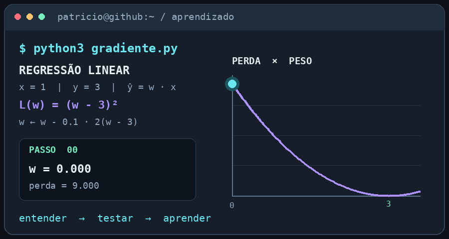

# Alysson Henrique Patrício da Silva

**Computer Science Student | Machine Learning & AI**

`Python` · `Mathematics` · `Machine Learning` · `Data Science`

Understanding the mathematics behind intelligent systems.

[LinkedIn](https://br.linkedin.com/in/alysson-henrique-patr%C3%ADcio-da-silva-596657449) · [Repositories](https://github.com/PatricioSva?tab=repositories)

---

## 01 · About Me

I am a Computer Science student at UNIESP, Brazil,
and an academic teaching assistant with a strong interest
in Machine Learning, Artificial Intelligence and mathematics.

My previous experience as a teacher shaped the way I approach
technology: understanding a concept is important, but being
able to explain why it works is equally valuable.

I am particularly interested in the mathematical foundations
of machine learning, algorithm implementation, optimization
and model evaluation.

My long-term goal is to build an international career
in Machine Learning.

## 02 · Technical Skills

**Machine Learning**
- Supervised and unsupervised learning
- Regression and classification
- Gradient descent and optimization
- Random Forest
- Feature engineering
- Model evaluation and baseline comparison

**Programming and Data**
- Python
- NumPy
- Pandas
- Scikit-learn
- SQL
- SQLite and MySQL
- Matplotlib

**Mathematical Foundations**
- Mathematical logic
- Linear algebra
- Calculus
- Probability and statistics

**Development Tools**
- Git and GitHub
- Linux
- Jupyter Notebook and Google Colab
- Visual Studio Code
- Streamlit

These skills represent different stages of academic
and practical development.

## 03 · Selected Projects

### Linear Regression from Scratch

Implementation of linear regression in Python,
exploring gradient descent, loss functions,
training and test separation, and model evaluation
without relying on a prebuilt regression estimator.

[View Repository](https://github.com/PatricioSva/linear-regression-from-scratch)

### Loja Vetor — Sales Analysis

An end-to-end data analysis project using synthetic
sales records, including data cleaning, financial
indicators, automated validation and visualization.

[View Repository](https://github.com/PatricioSva/loja-vetor-sales-analysis)

### Vehicle Rental Management System

An academic Python application integrating SQLite,
business rules, PDF receipts, CSV exports, Pandas
analytics, Streamlit and experimental demand forecasting
using Random Forest.

The forecasting experiment compares machine learning
performance against a simple baseline using synthetic data.

[View Repository](https://github.com/PatricioSva/vehicle-rental-management-system)

### CampusFood

A collaborative academic frontend project developed
with HTML5 and CSS3, featuring responsive navigation,
digital menus and food categories.

My contributions include project leadership,
architecture and primary development.

[View Repository](https://github.com/PatricioSva/CampusFood) |
[Live Demo](https://patriciosva.github.io/CampusFood/)

## 04 · Education and Teaching

- **BSc in Computer Science — UNIESP**
  Currently pursuing my undergraduate degree.

- **Academic Teaching Assistant — UNIESP**
  Supporting students in Python programming,
  mathematical logic, computer architecture
  and computer networks.

- **Former Teacher — Rota do Enem**
  Experience in educational planning,
  teaching and communication.

## 05 · Professional Development

- Machine Learning Specialization —
  DeepLearning.AI and Stanford Online, via Coursera.

- Amazing Data & AI Lab —
  Practical training in Python, data analysis and AI.

- Introduction to Cybersecurity —
  Cisco Networking Academy.

## 06 · Current Focus

- Implementing machine learning algorithms from scratch.
- Strengthening mathematical foundations.
- Developing reproducible experiments.
- Building documented and tested ML projects.
- Improving technical English and international communication.

## 07 · Languages and Interests

**Languages:** Portuguese (native), English and Mandarin
(currently developing proficiency).

**Personal interests:** Mathematics, technology,
piano, guitar, calisthenics and entrepreneurship.

---

Some projects were developed with AI assistance.
Their repositories document the implementation,
experimental limitations and learning objectives.

**Open to internships, research opportunities,
technical collaboration and continuous learning.**

[Connect with me on LinkedIn](https://br.linkedin.com/in/alysson-henrique-patr%C3%ADcio-da-silva-596657449)

